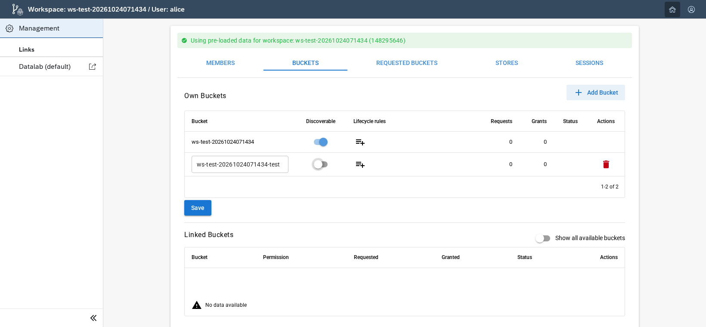
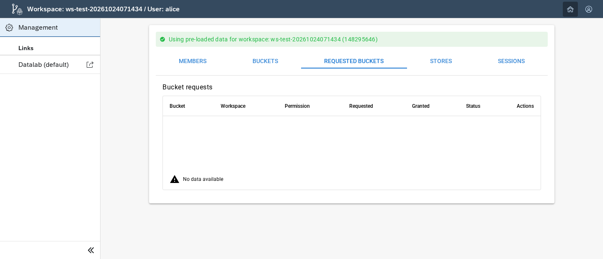
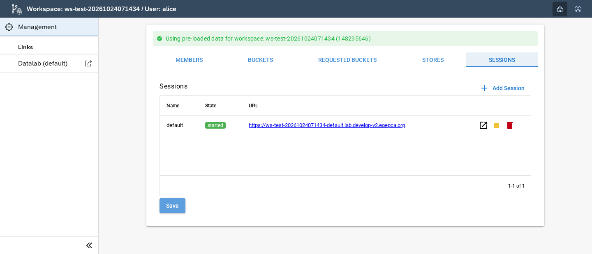
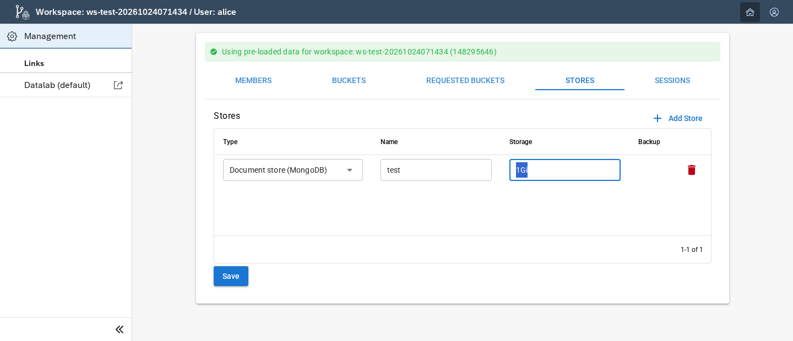
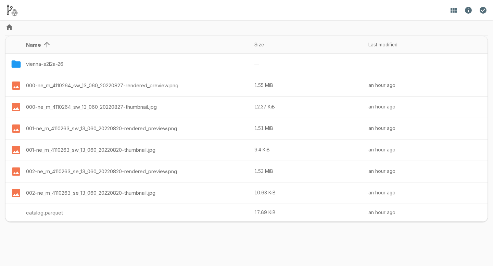
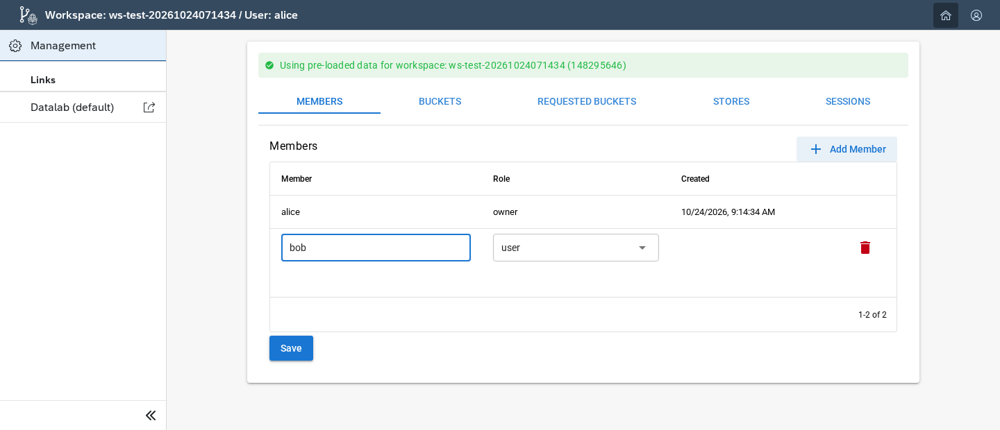

# Concepts

Open your workspace dashboard and select **Management** to manage members, buckets, sessions, and services. The available tabs and actions depend on your [workspace role](design/iam-integration.md#roles).

## Storage

A `Storage` resource defines buckets, a storage identity, access requests, grants, and lifecycle rules. Workspace members use that identity and its bucket permissions.

A discoverable bucket can appear in another workspace's access-request list. Its owner still has to approve access. The receiving workspace then uses its own storage credentials to reach the bucket.

| Permission | Access |
| --- | --- |
| `ReadOnly` | List and read objects. |
| `ReadWrite` | List, read, write, and delete objects. |
| `WriteOnly` | List, write, and delete objects, without reading their contents. |
| `None` | Record that access is not granted. |

For manifest-based setup, backends that resolve requests from peer `Storage` resources also need `storages.pkg.internal/discoverable: "true"` on the owner resource. The per-bucket `discoverable` field advertises the bucket; it is not a storage policy.

Lifecycle rules belong to `spec.buckets[].lifecycleRules`. A rule selects the whole bucket with `*` or a prefix such as `tmp/*`. `Notify` reports matching objects; `Delete` removes them. Set exactly one age (`minAge`, such as `12h`) or UTC cutoff (`at`).

See the provider's [permission model](https://github.com/versioneer-tech/provider-storage/blob/main/docs/how-to-guides/permissions.md) for backend details.

### Create a bucket

Open **Buckets**, add a unique bucket name, and save it. Start the name with your workspace name, for example `ws-test-20261024071434-test`. Wait for storage to finish creating the bucket before uploading files.

[](img/concepts/buckets.png)

Mark a bucket as discoverable to let other workspaces find it and request access. This does not make its objects public. See [public shares](#public-shares) for public downloads.

### Share a bucket with another workspace

1. In the receiving workspace, request access to the owner's discoverable bucket.
2. In the owner's workspace, open **Requested Buckets**, review the permission, and select **Grant bucket access**.
3. Wait for the storage policy to update.
4. In the receiving workspace, use its existing storage credentials to access the shared bucket.

[](img/concepts/requested-buckets.png)

Use `ReadOnly` for a reader. The [permission table](#storage) describes each level.

## Datalabs and sessions

A `Datalab` resource defines the team's users, sessions, and shared services. Each named session has an editor, terminal, and persistent home volume. Stopping the session keeps that volume.

Sessions share the workspace's storage identity and managed services. A session can use a host-cluster namespace or its own virtual Kubernetes control plane. See [operational controls](design/operational-controls.md) for the settings.

### Start or stop a session

Open **Sessions** to add a named session or change its state. Opening its Datalab link starts a stopped session when the API supports on-demand access.

[](img/concepts/sessions.png)

Shared storage, Data, and managed databases have separate lifecycles. See [session controls](design/operational-controls.md#sessions) for the initial mode and storage limits.

## Managed services

PostgreSQL, MongoDB, Redis, and Qdrant need their operators installed in the platform. A registry can provide a session endpoint for container images and OCI packages.

### Add a managed service

Use **Stores** to request an available service. The platform operator must install and configure its database operator first.

[](img/concepts/stores.png)

An operator can also add a service to the existing Datalab configuration. For example, this block requests a MongoDB store named `test`:

```yaml
spec:
  documentStores:
    test:
      storage: 1Gi
```

Keep the Datalab's other fields when adding this block. The session receives `MONGO_TEST_URI` after the service is ready. Stop and start the session to load changed connection settings.

Provider Datalab's [usage guide](https://provider-datalab.versioneer.at/latest/how-to-guides/usage_concepts/) describes the PostgreSQL, cache, vector, and registry fields. Its [application examples](https://provider-datalab.versioneer.at/latest/how-to-guides/additional_services/) cover tools such as MLflow.

## Data access and sharing

PackageR is the workspace storage browser. The Data service is enabled by default. An operator can give it a permanent address such as `https://<workspace-name>.lab.example.org`. The Datalab's Data tab opens that same service.

With a permanent address, storage browsing and public shares work without a running compute session. Sign in to browse private workspace data. A public share or presigned download link can be used without a workspace account.

### Public shares

Put files in the `public/` folder of the bucket named after the workspace. For `ws-bob`, this is `s3://ws-bob/public/`. The default share exposes that folder for public browsing and downloads. A `public/` folder in another bucket is not shared automatically.

Open `/share/public/` on the Data hostname. Every file placed in this folder is public. Upload files through PackageR when writes are allowed, or use the backing storage endpoint and its credentials.

[](img/quickstart/public-data.png)

### Presigned download links

A presigned URL gives temporary access to one object. In PackageR, select a file, open **Info**, then select **Show** beside **Presigned URL**.

This URL points to object storage. It works until it expires, and the recipient needs network access to that storage endpoint.

A public-share download route can redirect to a fresh presigned URL. Share that route when you need a link that lasts longer than one signed URL. [Workspace Management](workspace-management.ipynb) checks both download paths against the uploaded bytes.

### STAC catalogues

A public share can expose a `catalog.parquet` file with STAC items. Its asset paths are relative to the share folder. PackageR supplies public asset links when it serves the items.

The [Vienna notebook](getting-started/vienna-imagery-with-stac-and-s3.ipynb) publishes images and a catalogue together. The [registration notebook](getting-started/register-stac-metadata.ipynb) instead packages source metadata in OCI and serves it through a STAC API. The [notebook guide](usage/notebook-guide.md) compares the two workflows.

### S3 clients

The optional Data S3 endpoint lets AWS tools read data through the Data hostname. It uses path-style requests, and is read only. Uploads use the backing object-storage endpoint.

| Signing setting | Value |
| --- | --- |
| Endpoint | The workspace's permanent Data URL. |
| Access key ID | The workspace name. |
| Secret access key | The same workspace name. |
| Session token | A valid Keycloak access token. |

The signing names are public identifiers. The token must include the workspace name in `aud` and `ws_access`, `ws_admin`, or `ws_api` under that workspace's client roles. Human users can use device login through the central client. A service can use the generated workspace client's credentials.

The endpoint supports bucket and object listing, HEAD, GET, and byte-range GET. It rejects uploads and S3 query-presigned requests. S3 reads of `public/` objects still need a token; public-share links use a separate route.

Operators enable S3 through the [Gateway settings](getting-started/installation.md#example-values). The Vienna notebook refreshes its device login before the S3 and AWS CLI steps and checks the downloaded files by SHA-256.

## Membership

A workspace role controls dashboard and management actions. Members who can view storage credentials use the workspace's full storage policy, including its existing bucket grants.

The owner of another workspace approves any additional bucket grant. See [IAM roles](design/iam-integration.md#roles) for the management permissions.

### Add a member

1. Open **Members**.
2. Add an existing Keycloak username and select its workspace role.
3. Save the change.
4. Ask the new member to sign in again to load the assigned roles.

[](img/concepts/members.png)

Give workspace administrator access to people who need to manage members, buckets, sessions, or stores.

## Check a workspace that is still starting

An operator can inspect status without reading credential values:

```bash
kubectl get storage,datalab -n workspace
workspace_name=ws-test-20261024071434
kubectl describe datalab "$workspace_name" -n workspace
```

Set `workspace_name` to the name printed by your notebook. Check the reported conditions and events. If storage works but the Data hostname does not, check its workload, HTTPRoute, Gateway listener, certificate reference, DNS, and public load-balancer route.