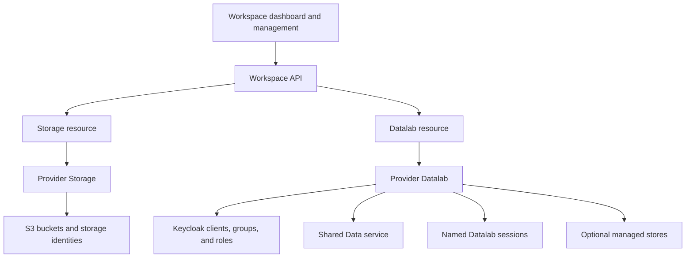

# Architecture

The Workspace API manages `Storage` and `Datalab` resources in Kubernetes. Crossplane runs their compositions to create and update storage, identity resources, sessions, and services.

## Storage and runtime

Provider Storage creates buckets, storage identities, policies, and credential Secrets. Backend compositions support MinIO, AWS S3, OTC OBS, OVHcloud, and CloudFerro.

Provider Datalab uses those storage credentials. It creates the shared Data service, requested stores, and the declared sessions. A session has its own home volume and can have a virtual Kubernetes control plane. Shared Data and managed stores can run while sessions are stopped.

The API and UI run as separate components from the composition packages. The pipeline chart installs the Storage and Datalab packages and their shared configuration. It does not deploy the Workspace API or UI.

## Shared configuration

An `EnvironmentConfig` holds the domain, IAM, storage, network, and default resource settings used by the compositions. A resource selects it with its environment annotation or label.

The pipeline chart creates one EnvironmentConfig, named `datalab` by default. Educates has separate installation values for the session ingress domain, class, and TLS Secret. Those values must match the Datalab environment settings. See [installation](../getting-started/installation.md).

Crossplane updates resources from the declared configuration. An operator can use GitOps or the Workspace API to manage that configuration. Assign each field to one writer so the API and GitOps do not replace each other's changes.

## Request paths

The platform gateway protects the Workspace API and browser session routes. The permanent Data endpoint has its own OAuth protection. Public shares and authenticated Data S3 reads use separate routes on the Data hostname.

Workloads created inside a vCluster still run on the host cluster. The host controls their network access, admission rules, and public routes. [IAM integration](iam-integration.md) describes token checks; [operational controls](operational-controls.md) describes the Workspace settings.
