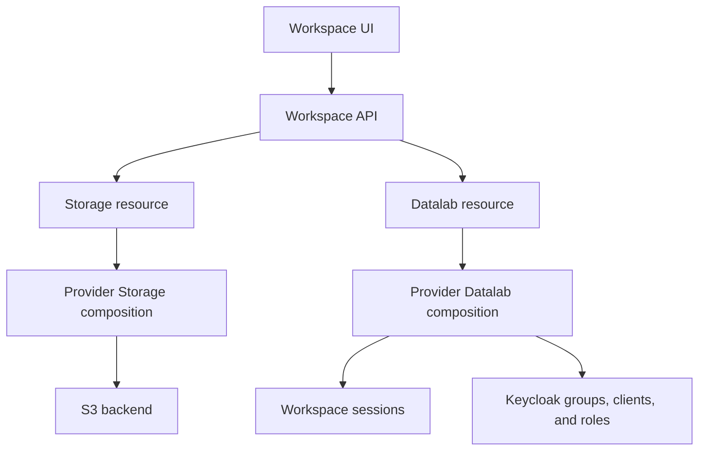

# Architecture

The Workspace API writes `Storage` and `Datalab` resources to Kubernetes. Crossplane compositions create and maintain the resources they describe.

## Compositions

The compositions use providers for Kubernetes, Helm, Keycloak, and the storage backend. Provider Storage creates buckets, storage identities, policies, and credential Secrets. It supports MinIO, AWS S3, and OTC OBS.

Provider Datalab creates the workspace session environment and the workspace's Keycloak resources. It makes storage credentials available to sessions and manages any backing services configured on the Datalab.

Crossplane reconciles changes to these resources. Operators can also write the manifests directly or manage them through GitOps. Avoid having the Workspace API and GitOps write the same fields.

## Shared configuration

An `EnvironmentConfig` holds settings used by the compositions: domains, TLS Secret names, storage endpoints, and Keycloak realm URLs. Storage and Datalab resources select it through labels or annotations.

The pipeline chart installs the two composition packages and creates the EnvironmentConfig. See [installation](../getting-started/installation.md) for package selection, values, and environment labels.

The platform gateway validates login tokens before forwarding requests to the Workspace API. [IAM integration](iam-integration.md) describes the clients and permissions. [Operational controls](operational-controls.md) covers runtime isolation and network rules.
