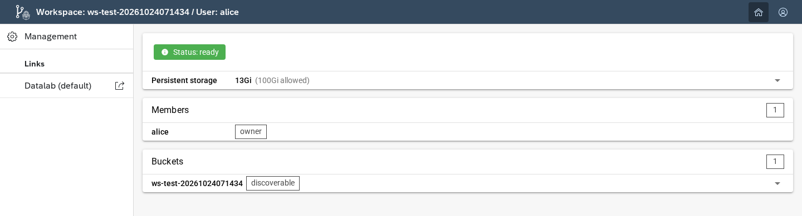
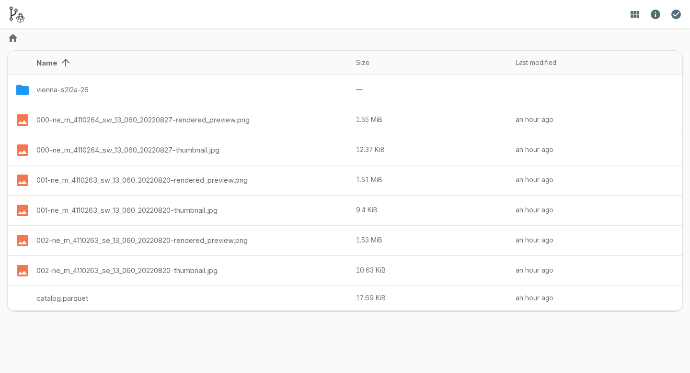
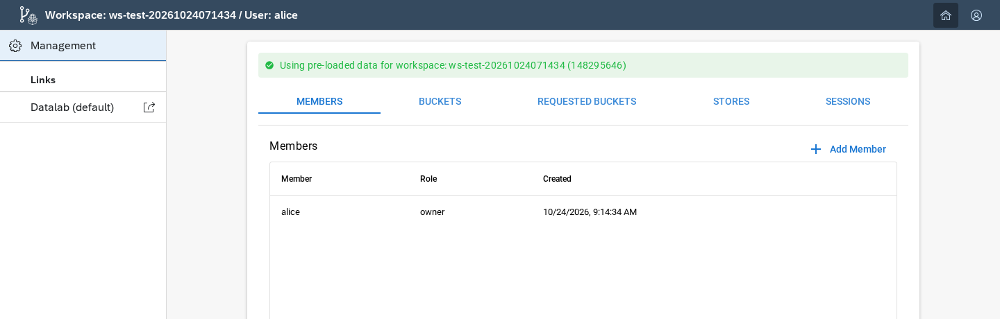

# Quickstart

Create a workspace, use its virtual cluster and registry, and publish data.

Start with Workspace Management if you need a test workspace. Then choose Vienna for public and S3 downloads, or STAC registration for an automated upload and search APIs. Use [STAC with managed PostgreSQL](stac-fastapi-pgstac.ipynb) to register the supplied three-Item sample in a PgSTAC database. The [notebook guide](../usage/notebook-guide.md) lists the services each example needs.

## What you need

These examples use `eoepca-demo`. The repository includes public service settings in `eoepca-demo.env` and a three-Item sample in `docs/catalog.v1.parquet`.

| Requirement | Used for |
| --- | --- |
| `alice` and `oscar` accounts | Alice owns the workspace; Oscar has the `workspace-api` platform `admin` role and creates it. |
| Storage and a permanent Data address | Upload files, browse public shares, and download data. |
| Data S3 endpoint enabled | Run the authenticated S3 and AWS CLI steps. |
| Workspace vCluster with an API kubeconfig profile | Run the STAC API notebooks. Registration deploys its registry in this vCluster. |

For a new platform, start with [components and environment configuration](installation.md). An operator sets up the [accounts and roles](https://github.com/EOEPCA/workspace/tree/main/setup). For another deployment, change the service settings and account names.

## 1. Create a workspace

From the repository root:

```bash
uv sync
uv run jupyter lab docs/workspace-management.ipynb
```

Run [Workspace Management](../workspace-management.ipynb). Sign in as Alice with device login, then as Oscar when the notebook asks for an administrator.

The notebook creates `ws-test-<UTC timestamp>`. On this demo, the workspace
includes storage, a `vc0` virtual cluster, a managed OCI registry, and Data.
Alice signs in again to obtain her new workspace roles. The notebook shows
the same HTTP call as the UI to add a namespace profile, exchanges a token
for that profile, and pushes and pulls a small package with ORAS. Use the
printed workspace name to run Vienna in this workspace. The STAC API
notebooks use the preconfigured `ws-alice` services.

The API returns a name, for example:

```json
{"name": "ws-test-20261024071434"}
```

The dashboard address is `WORKSPACE_API_ENDPOINT/<workspace-name>`. The API adds the configured `ws-` prefix to the preferred name.

## 2. Open the workspace

Open the dashboard link as Alice. Check the storage connection and Data link. Run the notebooks from your repository checkout. The STAC API notebooks download their workspace vCluster profiles through Workspace API.

For kubectl access, follow [Access a workspace virtual cluster](vcluster-access.md).
It shows device login as Alice, the offline CLI cache, and token exchange for
a process limited to the `demo` profile. The exchanged token has its own short
lifetime and no refresh token.

[](../img/quickstart/dashboard.png)

Workspace Management uploads the sample catalogue and one available preview image. It checks the image through an expiring S3 link and a permanent public-share link. Both downloads must match the uploaded bytes.

## 3. Publish and read satellite images

Open [Vienna imagery with STAC and S3](vienna-imagery-with-stac-and-s3.ipynb). Use Alice's existing `ws-alice`, or enter the workspace name from step 1.

Use this example to publish images that other people can inspect and download. The catalogue describes each cropped image, so a reader can find its date, area, and files. The notebook:

1. Crops three Sentinel-2 images over Vienna and creates previews.
2. Uploads those files and a STAC GeoParquet catalogue.
3. Reads the published STAC items and public image links.
4. Uses device login for authenticated S3 reads and the AWS CLI.
5. Checks a byte-range read and compares download checksums.

Existing image files with matching checksums are kept. A different image at the same key stops the upload. The shared catalogue retains other datasets.

Open `/share/public/` on the Data hostname to browse the published files:

[](../img/quickstart/public-data.png)

## 4. Publish, relocate, and serve STAC data

Run [Register STAC metadata](register-stac-metadata.ipynb) from your checkout. Sign in as Alice. The notebook gets storage credentials and the `ws-alice/vc0/demo` kubeconfig through Workspace API. The [example resources](https://github.com/EOEPCA/workspace/blob/main/setup/examples.yaml) configure that profile and its namespace.

Flow 1 prepares three Sentinel-5P cloud fraction observations from the DLR GeoService STAC endpoint for use around Vienna. Portolan describes the clips and uploads them under `published/`. A first workspace vCluster API demonstrates search through a local Kubernetes Service proxy. Flow 2 copies the assets to `public/` with stacpkg and keeps the source files. The metadata then uses PackageR HTTP asset links.

PackageR serves the public catalogue through the Data service. Preview it in MoreGeo STAC Browser and update the first API with the public metadata. Flow 3 deploys CNCF Distribution inside the workspace vCluster. A publisher Job pushes the metadata package, and a second API pulls it by digest. The [notebook guide](../usage/notebook-guide.md#process-data-and-add-search) compares the views.

Each registration run selects three observations. It keeps older published data and shared catalogue entries. The notebooks leave the workspace, uploaded files, and OCI package available for inspection. Registry artifacts stay on its PVC across Pod restarts.

## 5. Work with a team

Use the management page to add members and manage bucket access. Members use the workspace's storage identity. To use a bucket owned by another workspace, request access and have its owner approve the grant.

[](../img/quickstart/members.png)

See [Concepts](../concepts.md) for the access model and steps for managing members, bucket grants, and sessions.

## 6. Use managed services

A workspace can request PostgreSQL, MongoDB, Redis, or Qdrant when the platform has the required operators. Use the **Stores** tab when these services are available. Their connection settings appear on the dashboard and in new Datalab sessions.

For operator configuration and application examples, see [Add a managed service](../concepts.md#add-a-managed-service).
