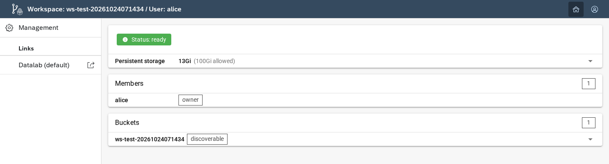
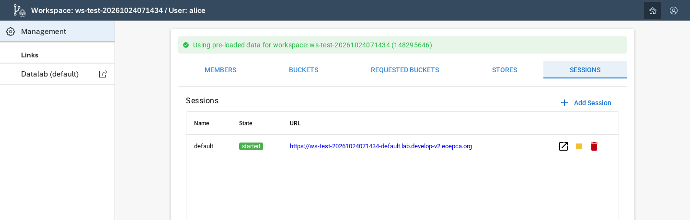
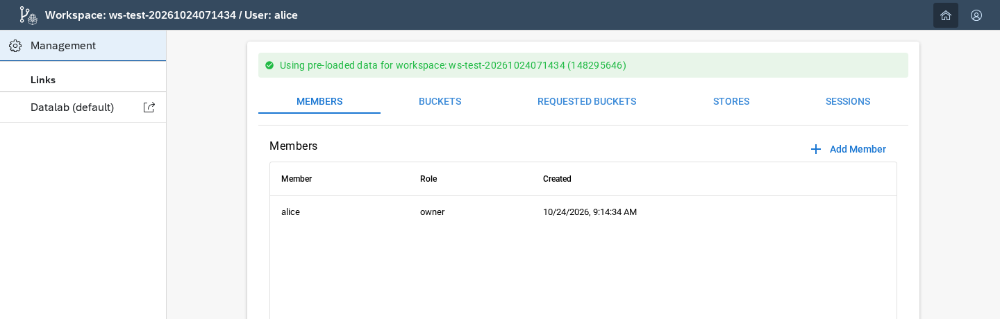

# Quickstart

Create a test workspace, publish images, and serve STAC metadata. Use the same workspace for all three notebooks.

## Environment assumptions

These examples use `eoepca-demo`. The repository includes public service settings in `eoepca-demo.env` and a three-Item sample in `docs/catalog.v1.parquet`.

| Requirement | Used for |
| --- | --- |
| `alice` and `oscar` accounts | Alice owns the workspace; Oscar has the `workspace-api` platform `admin` role and creates it. |
| Storage and a permanent Data address | Upload files, browse public shares, and download data. |
| Data S3 endpoint enabled | Run the authenticated S3 and AWS CLI steps. |
| Datalab with vCluster and registry | Run the STAC registration notebook. |

An operator sets up the [accounts and roles](https://github.com/EOEPCA/workspace/tree/main/setup) and [installs Workspace](installation.md). For another deployment, change the service settings and account names.

## 1. Create a workspace

From the repository root:

```bash
uv sync
uv run jupyter lab docs/workspace-management.ipynb
```

Run [Workspace Management](../workspace-management.ipynb). Sign in as Alice with device login, then as Oscar when the notebook asks for an administrator.

The notebook creates `ws-test-<UTC timestamp>`, waits for storage, and refreshes Alice's token to load her workspace roles. Copy the printed workspace name for the other notebooks.

The API returns a name, for example:

```json
{"name": "ws-test-20261024071434"}
```

The dashboard address is `WORKSPACE_API_ENDPOINT/<workspace-name>`. The API adds the configured `ws-` prefix to the preferred name.

## 2. Open the workspace

Open the dashboard link as Alice. It shows the storage connection and available sessions. Open a Datalab session to use its editor, terminal, and Data tab.

[](../img/quickstart/dashboard.png)

In on-demand mode, opening a stopped session starts it. Storage and the permanent Data service can be available before the session starts. The notebook waits separately for storage and the public Data route.

Use **Management → Sessions** to check the `default` session:

[](../img/quickstart/sessions.png)

Workspace Management uploads the sample catalogue and six preview images. It checks each image through an expiring S3 link, then through a permanent public-share link. Both downloads must match the uploaded bytes.

## 3. Publish and read satellite images

Open [Vienna imagery with STAC and S3](vienna-imagery-with-stac-and-s3.ipynb) and enter the workspace name from step 1.

The notebook:

1. Crops three Sentinel-2 images over Vienna and creates previews.
2. Uploads those files and a STAC GeoParquet catalogue.
3. Reads the published STAC items and public image links.
4. Uses device login for authenticated S3 reads and the AWS CLI.
5. Checks a byte-range read and compares download checksums.

Existing objects with matching checksums are kept. A different file at the same key stops the upload.

Open `/share/public/` on the Data hostname to browse the published files:

[](../img/quickstart/public-data.png)

## 4. Register metadata without copying the rasters

Start the workspace's `default` Datalab session. Open [Register STAC metadata](register-stac-metadata.ipynb) in that session and set its workspace name as described there.

The notebook selects three STAC items from DLR's Geoservice, builds an OCI metadata package, and starts a STAC API in the session's vCluster. It checks the package after each transfer. The raster files remain at the source.

The notebooks leave the workspace, uploaded files, and OCI package available for inspection.

## 5. Work with a team

Use the management page to add members and manage bucket access. Members use the workspace's storage identity. To use a bucket owned by another workspace, request access and have its owner approve the grant.

[](../img/quickstart/members.png)

See [Concepts](../concepts.md) for the access model and steps for managing members, bucket grants, and sessions.

## 6. Use managed services

A workspace can request PostgreSQL, MongoDB, Redis, or Qdrant when the platform has the required operators. Use the **Stores** tab when these services are available. Their connection settings appear on the dashboard and in new Datalab sessions.

For operator configuration and application examples, see [Add a managed service](../concepts.md#add-a-managed-service).
