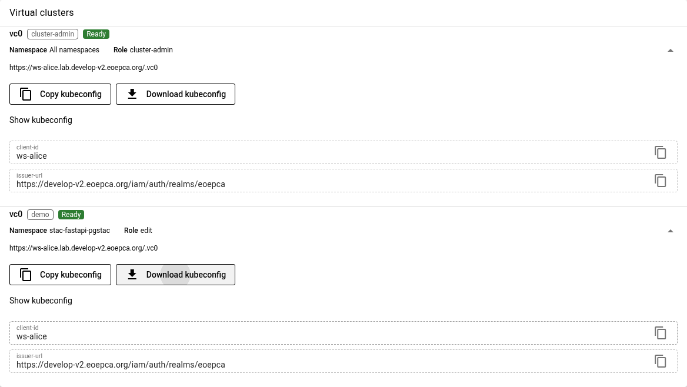
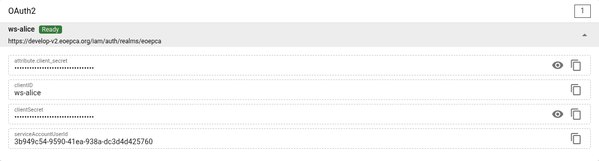
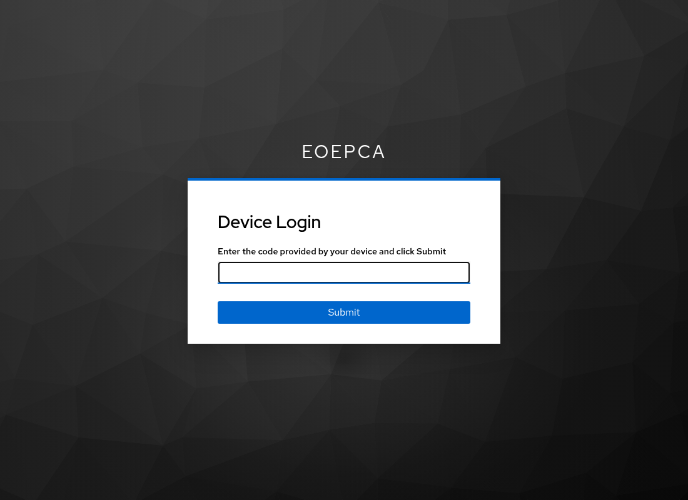
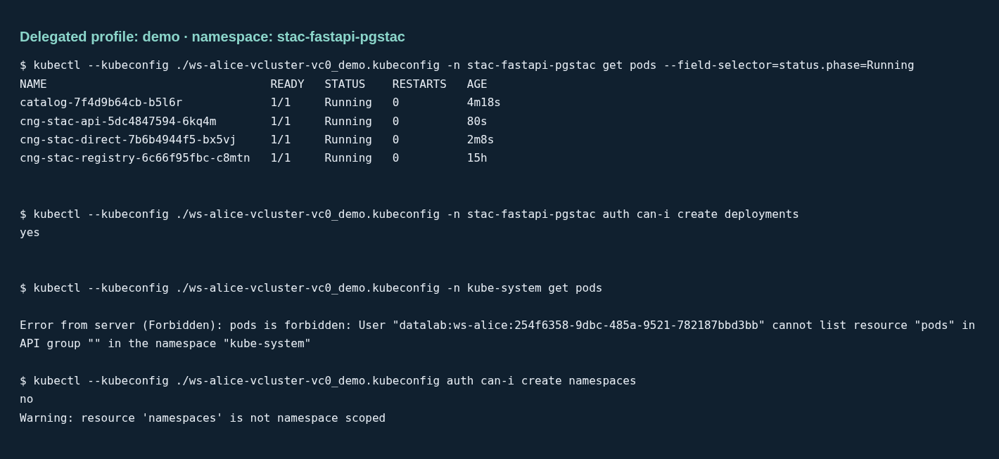

# Access a workspace virtual cluster

Use the workspace dashboard to download a kubeconfig. Use your own identity
for interactive work, or give a process an exchanged token for one access
profile. Downloading a kubeconfig does not grant or reduce permissions.

The [Provider Datalab guide](https://github.com/versioneer-tech/provider-datalab/blob/main/docs/how-to-guides/vcluster.md#api-access)
explains the generated profiles, direct operator downloads, login cache, and
revocation. This guide shows the Workspace API and UI flow.

The examples use Alice's workspace in `eoepca-demo`:

| Setting | Value |
| --- | --- |
| Dashboard | [Alice's workspace](https://workspace-api.develop-v2.eoepca.org/workspaces/ws-alice?resolve_connections=*&resolve_oauth2=*) |
| Virtual cluster | `vc0` |
| Administrator profile | `cluster-admin`, all namespaces |
| Delegation profile | `demo`, Kubernetes `edit` in `stac-fastapi-pgstac` |
| Delegation scope | `ws-alice:vclusters_vc0_demo` |

Install `kubectl` and Python 3. Use Bash for the shell commands. For the token
exchange script, run `uv sync` from this repository first.

## How Workspace API supplies access

The provider publishes ready profiles and OAuth2 client references. Workspace
API checks your workspace permissions, reads the referenced connection
Secrets, and supplies the permitted values to the dashboard. You do not need
a host-cluster kubeconfig or Kubernetes Secret access.

The **Virtual clusters** card provides **Download kubeconfig**. The separate
**OAuth2** card provides the workspace client credentials. Users with
`ws_access` or `ws_admin` can retrieve these values. A caller with only
`ws_api` can retrieve service connections, including ready vcluster profiles,
but cannot retrieve OAuth2 client credentials.

A download selects an API endpoint and default namespace. The access token
and Kubernetes RBAC determine what the caller can do. Provider Datalab
automatically grants workspace administrators `ws_admin` and the built-in
`vcluster_<instance>_cluster-admin` role for each configured instance.
Alice therefore already has `vcluster_vc0_cluster-admin`; no separate role
assignment is needed. The virtual API checks this vcluster role, while
`ws_admin` controls workspace management.

## Case 1: Sign in as Alice

### 1. Download the administrator profile

Sign in to the dashboard as Alice. In **Virtual clusters**, expand the ready
`vc0` entry with the `cluster-admin` profile. Select **Download kubeconfig**.
Rename the downloaded file to `ws-alice-vc0.kubeconfig` in your working
directory. The generated download name can include a hash.



Download a current kubeconfig to use offline login. Older downloads keep
their embedded helper and login scopes until you replace them.

The profile supports device login. Alice's issued token must contain
`vcluster_vc0_cluster-admin` for administrator access.

### 2. Supply the OAuth2 client secret locally

In **OAuth2**, expand the ready `ws-alice` client and copy its client secret.
Use the `clientSecret` field.
Save only the secret value, without a JSON or YAML wrapper. This command asks
for it without displaying it or putting it in shell history:

```bash
umask 077
unset DATALAB_ACCESS_TOKEN_FILE
python3 - <<'PY'
from getpass import getpass
from pathlib import Path

directory = Path.home() / ".config/datalab"
directory.mkdir(mode=0o700, parents=True, exist_ok=True)
path = directory / "ws-alice-client-secret"
value = getpass("Workspace OAuth2 client secret: ")
if not value:
    raise SystemExit("The client secret is required.")
path.touch(mode=0o600, exist_ok=True)
path.chmod(0o600)
path.write_text(value)
PY
export DATALAB_CLIENT_SECRET_FILE="$HOME/.config/datalab/ws-alice-client-secret"
```



The secret authenticates the OAuth client. The browser login identifies
Alice and selects her user permissions. The kubeconfig contains neither a
client secret nor a user token.

### 3. Start kubectl and approve the device login

```bash
kubectl --kubeconfig ./ws-alice-vc0.kubeconfig get namespaces
kubectl --kubeconfig ./ws-alice-vc0.kubeconfig \
  auth can-i '*' '*' --all-namespaces
```

On the first call, the embedded helper prints a verification URL and a user
code. Open the URL, enter the code, sign in as Alice, and approve the request.
The waiting command then continues. The authorization check must return
`yes` for Alice's administrator role.



The browser login to the dashboard and this kubectl login are separate OAuth
flows. An existing browser session can simplify approval, but it does not
populate the kubectl token cache.

### 4. Reuse the cached login

The current helper requests `openid offline_access ws-alice:interactive`.
It saves the access token, offline refresh token, and local login deadline in
`~/.cache/datalab/oidc/<hash>.json`. It uses
`$XDG_CACHE_HOME/datalab/oidc` when set, or `DATALAB_TOKEN_CACHE_DIR` for an
explicit directory. The directory has mode `0700`; cache files have mode
`0600`. The client secret is not stored there.

| Credential or session | Lifetime |
| --- | --- |
| Access token | 5 minutes in the tested demo login. |
| CLI cached login | Up to 30 days after device approval. Refresh does not extend this local deadline. |
| Offline session | Subject to Keycloak's offline idle and maximum limits and revocation. Provider Datalab sets a 30-day client idle limit. Its 30-day client maximum applies when the realm enables Offline Session Max Limited. Shorter realm limits can end access sooner. |

When kubectl runs near access-token expiry, the helper attempts renewal with
the cached offline refresh token and client secret. Successful renewal needs
no browser approval. Keep
`DATALAB_CLIENT_SECRET_FILE` set for refresh; set it again in a new shell.
There is no background refresh while kubectl is idle. After the local deadline
or an `invalid_grant` response, the helper starts device login again. Other
renewal errors stop the command. The provider guide describes how to
[start a fresh device login](https://github.com/versioneer-tech/provider-datalab/blob/main/docs/how-to-guides/vcluster.md#5-reuse-the-login).

Ordinary browser logout does not revoke offline access. Revoke the workspace
client's offline access in Keycloak to stop further refresh. An already issued
access token can remain usable until its expiry. See the provider's
[human login lifetime](https://github.com/versioneer-tech/provider-datalab/blob/main/docs/how-to-guides/vcluster.md#human-login-lifetime)
and [Keycloak offline access](https://www.keycloak.org/docs/latest/server_admin/index.html#_offline-access)
for the session settings and revocation controls.

The notebooks use a separate public-client login and keep tokens in kernel
memory. Passing one of those tokens through `DATALAB_ACCESS_TOKEN_FILE` does
not use this offline cache. See [notebook logins](../usage/notebook-guide.md#login-and-token-lifetimes).

If your user has only an additional namespace role, the administrator profile
can still perform device login. Request the matching optional scope as shown
under [human access](https://github.com/versioneer-tech/provider-datalab/blob/main/docs/how-to-guides/vcluster.md#human-access).
The resulting token grants that namespace role. It does not grant
cluster administration.

## Case 2: Delegate the demo profile to a process

Alice remains the human identity in the exchanged token. The process gets
the `demo` kubeconfig and the exchanged access token. Alice keeps her original
login and any client credentials.

### 1. Download the demo profile

In Alice's dashboard, expand **Virtual clusters > vc0 > demo** and select
**Download kubeconfig**. Save it as `ws-alice-vcluster-vc0_demo.kubeconfig`.
Check that the displayed namespace is `stac-fastapi-pgstac` and the role is
`edit`.

The profile uses `--token-only`. It cannot start device login or refresh a
token. Giving it Alice's unrestricted token would retain her wider access.

### 2. Exchange Alice's user token

Run this script from the repository root. It uses the same public client and
device login as the notebooks. Approve the login as Alice. This approval is
for the delegator; the recipient will have no login prompt.

```bash
umask 077
uv run python - <<'PY'
from pathlib import Path
import sys

sys.path.insert(0, "docs")
from notebook_support import ApiSession, load_config, workspace_login

config = load_config("eoepca-demo.env", "workspace")
tokens = workspace_login(config, "alice")
with ApiSession() as api:
    response = api.get(
        config["WORKSPACE_API_ENDPOINT"] + "/ws-alice/token",
        headers={"Authorization": "Bearer " + tokens["access_token"]},
        params={"scope": "ws-alice:vclusters_vc0_demo"},
    )
    response.raise_for_status()
    delegated = response.json()

path = Path("ws-alice-vc0-demo.token")
path.touch(mode=0o600, exist_ok=True)
path.chmod(0o600)
path.write_text(delegated["access_token"])
print(f"Saved {path}; expires in {delegated['expires_in']} seconds.")
PY
```

Workspace API performs token exchange with its stored workspace client
credentials. It checks the returned signature, issuer, subject, audiences,
scopes, and roles before returning the token. Alice needs token-issuance
permission, `ws_api`, and `vcluster_vc0_demo`. The resulting workspace roles
are `ws_api` and `vcluster_vc0_demo`; administrator roles are absent.

The `scope` query is required. A call to `/ws-alice/token` without it requests
a service-account token with only `ws_api`, which cannot access the virtual
cluster. See the [Workspace token API](https://github.com/EOEPCA/rm-workspace-api/blob/main/docs/workspace-tokens.md#scoped-user-token-exchange).

### 3. Give the files to the process and run kubectl

Transfer the kubeconfig and token file through a private channel. On the
recipient's machine, in the directory with both files:

```bash
unset DATALAB_CLIENT_SECRET_FILE
export DATALAB_ACCESS_TOKEN_FILE="$PWD/ws-alice-vc0-demo.token"
chmod 600 "$DATALAB_ACCESS_TOKEN_FILE"
kubectl --kubeconfig ./ws-alice-vcluster-vc0_demo.kubeconfig \
  -n stac-fastapi-pgstac get pods --field-selector=status.phase=Running
kubectl --kubeconfig ./ws-alice-vcluster-vc0_demo.kubeconfig \
  -n stac-fastapi-pgstac auth can-i create deployments
```

The first call lists running Pods without a login prompt. The authorization check
returns `yes`. `DATALAB_ACCESS_TOKEN_FILE` is the path to a file that contains
only the JWT, without `Bearer ` or a JSON wrapper. It is not the token value.

### 4. Check that other namespaces are denied

```bash
kubectl --kubeconfig ./ws-alice-vcluster-vc0_demo.kubeconfig \
  -n kube-system get pods
kubectl --kubeconfig ./ws-alice-vcluster-vc0_demo.kubeconfig \
  auth can-i create namespaces
```

The Pod request must fail with `Forbidden`. The second check returns `no`
and a nonzero exit status. The token permits `edit` operations only in
`stac-fastapi-pgstac`, unless that identity has another applicable Kubernetes
binding. Its `ws_api` role also permits service credential reads through
Workspace API; the namespace restriction applies to Kubernetes access.

These checks passed on `eoepca-demo` on 2026-11-07. This image shows the
recorded command output from that run:



### 5. Replace the token when it expires

The token's `exp` claim sets its expiry. The script reports the issuer's
`expires_in`; it does not promise a fixed duration. The recipient has no
refresh token, uses no device-login cache, and must obtain a new exchange
result from Alice or the issuing service after expiry.

The virtual API validates JWTs locally. Keycloak logout, removal of Alice's
role, revocation of offline access, client-secret rotation, or deletion of a
token file does not reliably invalidate copies of an issued token before
`exp`. There is no individual
JWT revocation list in this setup. An operator can remove the profile or its
RBAC binding to deny access sooner, after reconciliation. This affects every
caller that needs that profile or binding. See
[lifetime and revocation](https://github.com/versioneer-tech/provider-datalab/blob/main/docs/how-to-guides/vcluster.md#delegated-token-lifetime-and-revocation).
