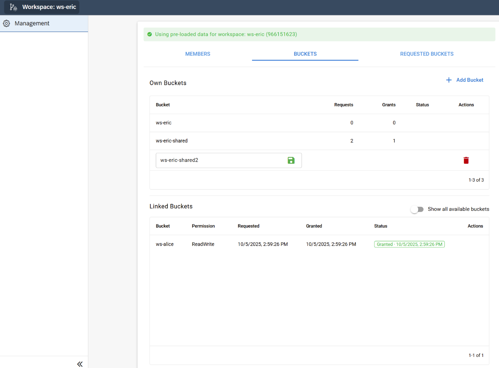
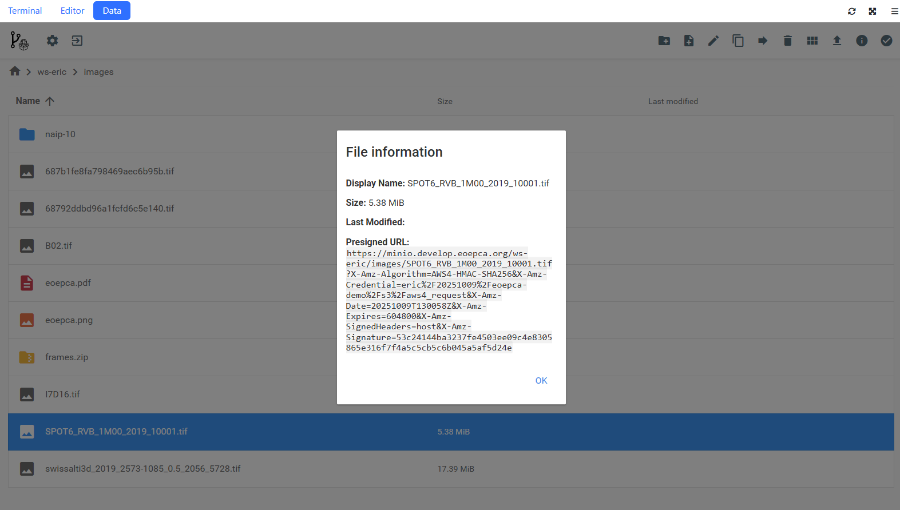

# Workspace

A workspace gives a team S3 buckets and a Datalab where they can write and run code. Use the Workspace UI to add members, manage buckets, and start a session.

  

The Datalab opens in your browser. Use its editor and terminal to work on code, and the **Data** tab to open PackageR.

  

Follow the [quickstart](getting-started/quickstart.md) to work through a team project. For API calls for operators or end users, open the [Workspace Management notebook](workspace-management.ipynb). The [concepts](concepts.md) page explains buckets, sessions, and membership.

To set up a deployment, see [installation](getting-started/installation.md). Operators can set [runtime and network limits](design/operational-controls.md) and configure [login and roles](design/iam-integration.md).
